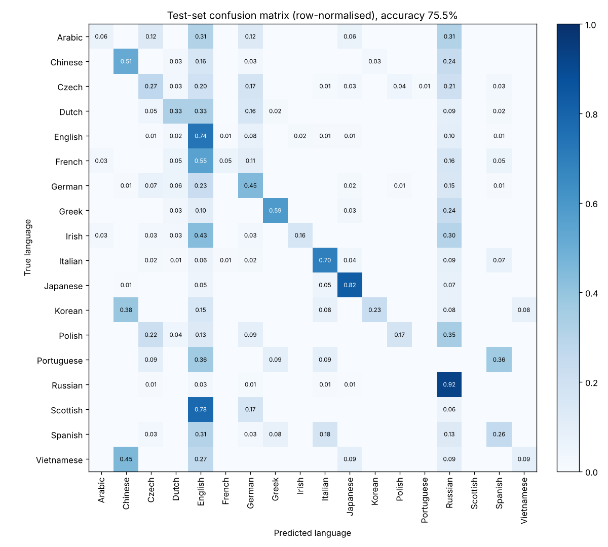
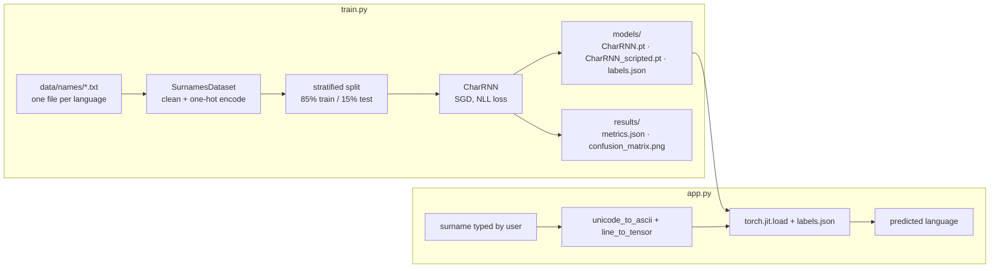

# Surname Origin Classifier — Character-level RNN (PyTorch + Streamlit)

[](https://github.com/kishorhange111/surname-origin-classifier-rnn/actions/workflows/ci.yml)


**Type a surname and a character-level RNN predicts which of 18 languages it most likely comes from. Trained in PyTorch, exported with TorchScript, and served through a Streamlit app that runs on CPU in milliseconds.**

The task: *Nakamura* is a Japanese surname and *Rossi* an Italian one. Can a model learn that from spelling alone?

## Results
Held-out, stratified test set: **3,009 names** (15 % of every language, seed 2024), never seen during training.

| Metric | Test set |
|---|---|
| Accuracy | **78.1 %** |
| Macro F1 (every language weighted equally) | **0.408** |
| Weighted F1 (weighted by language size) | 0.769 |
| Majority-class baseline (always "Russian") accuracy | 46.8 % |

The data is **heavily imbalanced**: Russian is 46.8 % of all 20,050 names, while Vietnamese and Portuguese have fewer than 75 each. That is why macro F1 is reported next to accuracy: accuracy is dominated by the big classes, macro F1 shows how the model does on every language. The large, distinctive classes (Arabic, Russian, Japanese) are learned well; small classes whose names look English, Italian or Chinese to a character model (Scottish, Portuguese, Vietnamese) are not recognised at all.

<details>
<summary>Per-language results (test set)</summary>

| Language | Names in dataset | Test names | Precision | Recall | F1 |
|---|---|---|---|---|---|
| Arabic | 2,000 | 300 | 0.949 | 0.990 | 0.969 |
| Chinese | 268 | 40 | 0.547 | 0.725 | 0.624 |
| Czech | 519 | 78 | 0.357 | 0.256 | 0.299 |
| Dutch | 297 | 45 | 0.524 | 0.244 | 0.333 |
| English | 3,668 | 550 | 0.624 | 0.842 | 0.717 |
| French | 277 | 42 | 0.421 | 0.190 | 0.262 |
| German | 724 | 109 | 0.395 | 0.275 | 0.324 |
| Greek | 203 | 30 | 0.727 | 0.533 | 0.615 |
| Irish | 232 | 35 | 0.500 | 0.200 | 0.286 |
| Italian | 709 | 106 | 0.503 | 0.811 | 0.621 |
| Japanese | 991 | 149 | 0.864 | 0.765 | 0.811 |
| Korean | 94 | 14 | 0.200 | 0.071 | 0.105 |
| Polish | 139 | 21 | 0.333 | 0.095 | 0.148 |
| Portuguese | 74 | 11 | 0.000 | 0.000 | 0.000 |
| Russian | 9,384 | 1408 | 0.936 | 0.890 | 0.913 |
| Scottish | 100 | 15 | 0.000 | 0.000 | 0.000 |
| Spanish | 298 | 45 | 0.387 | 0.267 | 0.316 |
| Vietnamese | 73 | 11 | 0.000 | 0.000 | 0.000 |

</details>



All numbers come from [`results/metrics.json`](results/metrics.json), written by `train.py`; a unit test fails if this README and that file disagree.

## Model at a glance
| | |
|---|---|
| Input | surname, one character at a time, one-hot over a 32-symbol vocabulary |
| Model | single-layer RNN (hidden 256) → Linear 256→128 → Linear 128→18 → LogSoftmax |
| Classes | 18 languages: Arabic, Chinese, Czech, Dutch, English, French, German, Greek, Irish, Italian, Japanese, Korean, Polish, Portuguese, Russian, Scottish, Spanish, Vietnamese |
| Data | 20,050 names, stratified 85/15 train/test split (seed 2024) |
| Training | mini-batches of 64, SGD (lr 0.15) with gradient clipping, NLL loss, 27 epochs (7 min on CPU) |
| Serving | TorchScript (`models/CharRNN_scripted.pt`), Streamlit |

## How it works

1. **Preprocessing** — each surname is normalised to plain ASCII (lower-cased, accents stripped: *Müller → muller*) and one-hot encoded one character at a time over a 32-symbol vocabulary (a–z, space, `.,;'` and `_` for unknown characters) → a `(length, 1, 32)` tensor.
2. **Model** — a single-layer RNN (hidden size 256) reads the name letter by letter; its final hidden state goes through two linear layers and a LogSoftmax over the 18 languages.
3. **Training** — stratified, seeded 85/15 train/test split (every language keeps its share in the test set), mini-batches of 64, SGD (lr 0.15) with gradient clipping, NLL loss, 27 epochs. Evaluation on the held-out test set reports accuracy, per-language precision/recall/F1 and macro F1, and saves a confusion-matrix plot.
4. **Deployment** — the trained model is exported with `torch.jit.script`, so the app loads it without the Python class definitions and runs inference in milliseconds on CPU.

## Quickstart
```bash
git clone https://github.com/kishorhange111/surname-origin-classifier-rnn.git
cd surname-origin-classifier-rnn
pip install -r requirements.txt
streamlit run app.py             # or: make run
```
Or open the repository in **GitHub Codespaces**: the dev container installs everything and starts the app.

### Retrain the model
```bash
curl -O https://download.pytorch.org/tutorial/data.zip && unzip data.zip   # data/names/*.txt  (or: make data)
python train.py --data data/names --epochs 27                              # (or: make train)
```
Training writes the weights, the TorchScript model, `models/labels.json` (the label order used, which the app requires) and the test metrics in `results/`. It is seeded, so a re-run on the same data and torch version reproduces the model. See [`data/README.md`](data/README.md) for the dataset.

## Project layout
```
surname-origin-classifier-rnn/
├── app.py                       # Streamlit UI (loads the TorchScript model)
├── train.py                     # train → evaluate → export models/
├── surname_classifier/          # the Python package
│   ├── preprocessing.py         #   ASCII normalisation, one-hot encoding, label decoding
│   ├── model.py                 #   CharRNN definition
│   ├── dataset.py               #   PyTorch Dataset (one .txt file per language), stratified split
│   ├── metrics.py               #   accuracy, per-class precision/recall/F1, confusion-matrix plot
│   └── inference.py             #   load the exported model + labels.json, predict
├── models/
│   ├── CharRNN.pt               # trained weights (state_dict)
│   ├── CharRNN_scripted.pt      # TorchScript export used by the app
│   └── labels.json              # output-unit -> language order the model was trained with
├── results/
│   ├── metrics.json             # test-set metrics, class counts, training settings
│   └── confusion_matrix.png
├── tests/                       # pytest suite (CPU, offline)
├── data/README.md               # how to download the training data
├── pyproject.toml               # metadata, ruff + pytest config
├── requirements.txt             # pinned runtime dependencies
├── requirements-dev.txt         # pytest, ruff
├── Makefile                     # make run / data / train / test / check
└── .devcontainer/               # one-click GitHub Codespaces setup
```

## Testing
```bash
pip install -r requirements.txt -r requirements-dev.txt
make check                       # = ruff check . && pytest
```
The suite runs on CPU with no downloads. It covers name cleaning and one-hot encoding, deterministic label order and the stratified split, the metric calculations (checked by hand), CharRNN output shapes and log-probabilities, the TorchScript round trip, that the committed TorchScript model matches the committed weights, a short training run on toy data that must reach 100 % accuracy, that the app's labels come from `labels.json`, that the README numbers match `results/metrics.json`, rejection of inputs with no usable characters, and Streamlit `AppTest` smoke tests of the real app. CI runs it on every push and pull request.

## Design notes
- **Why character-level?** Surnames carry strong sub-word signals (*-ov*, *-ski*, *-ez*, *Mc-*, *-moto*) that a character model learns directly, with no vocabulary to maintain.
- **Deterministic labels:** label order is sorted and saved with the model as `labels.json`, and the app refuses to run without it, so a model can never be paired with the wrong language names. (An earlier version of this repo shipped a hard-coded label list that did not match the model's output order; this retrain fixed that.)
- **Why TorchScript?** A serialised, self-contained graph: the serving code doesn't need the training code, and the same file can be loaded from C++.

## Limitations
- **Class imbalance.** Unweighted training on data that is 46.8 % Russian: small languages are under-predicted, and Portuguese, Scottish and Vietnamese get an F1 of 0 on the test set. Class-weighted loss or oversampling would be the first thing to try.
- **Ambiguous labels.** Many surnames are shared across languages (and Scottish, Irish and English names overlap heavily), so a single "origin" label is inherently uncertain.
- **Small test sets for rare languages.** Some languages have only 11–15 test names, so their per-language scores are noisy.
- **Simple model.** A vanilla RNN, one name per step and no padding/packing; an LSTM/GRU or a small transformer would likely do better.
- **Data copy.** `download.pytorch.org` was not reachable when this model was trained, so the PyTorch tutorial's `data/names` files were taken from the copy in [spro/practical-pytorch](https://github.com/spro/practical-pytorch/tree/master/data/names) (20,050 names).

## Tech stack
Python · PyTorch · TorchScript · Streamlit · NumPy · pytest · ruff · GitHub Actions
