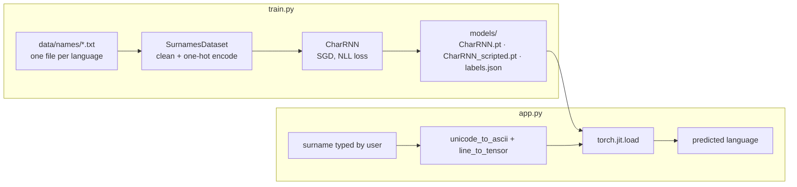

# Surname Origin Classifier — Character-level RNN (PyTorch + Streamlit)

[](https://github.com/kishorhange111/surname-origin-classifier-rnn/actions/workflows/ci.yml)


**Type a surname and a character-level RNN predicts which of 18 languages it most likely comes from. Trained in PyTorch, exported with TorchScript, and served through a Streamlit app that runs on CPU in milliseconds.**

The task: *Nakamura* is a Japanese surname and *Rossi* an Italian one. Can a model learn that from spelling alone?

## Model at a glance
| | |
|---|---|
| Input | surname, one character at a time, one-hot over a 32-symbol vocabulary |
| Model | single-layer RNN (hidden 256) → Linear 256→128 → Linear 128→18 → LogSoftmax |
| Classes | 18 languages: Arabic, Chinese, Czech, Dutch, English, French, German, Greek, Irish, Italian, Japanese, Korean, Polish, Portuguese, Russian, Scottish, Spanish, Vietnamese |
| Data | ~20k names, 85/15 train/validation split (seeded) |
| Training | mini-batches of 64, SGD (lr 0.15) with gradient clipping, NLL loss, 27 epochs |
| Serving | TorchScript (`models/CharRNN_scripted.pt`), Streamlit |

## How it works

1. **Preprocessing** — each surname is normalised to plain ASCII (accents stripped: *é → e*) and one-hot encoded one character at a time over a 32-symbol vocabulary (a–z, space, `.,;'` and `_` for unknown characters) → a `(length, 1, 32)` tensor.
2. **Model** — a single-layer RNN (hidden size 256) reads the name letter by letter; its final hidden state goes through two linear layers and a LogSoftmax over the 18 languages.
3. **Training** — ~20k names, 85/15 train/validation split (seeded), mini-batches of 64, SGD (lr 0.15) with gradient clipping, NLL loss, 27 epochs. Evaluation prints a per-language confusion matrix and overall validation accuracy.
4. **Deployment** — the trained model is exported with `torch.jit.script`, so the app loads it without the Python class definitions and runs inference in milliseconds on CPU.

## Quickstart
```bash
git clone https://github.com/kishorhange111/surname-origin-classifier-rnn.git
cd surname-origin-classifier-rnn
pip install -r requirements.txt
streamlit run app.py             # or: make run
```
Or open the repository in **GitHub Codespaces**: the dev container installs everything and starts the app.

### Retrain the model
```bash
curl -O https://download.pytorch.org/tutorial/data.zip && unzip data.zip   # data/names/*.txt  (or: make data)
python train.py --data data/names --epochs 27                              # (or: make train)
```
Training writes the weights, the TorchScript model and `models/labels.json` (the label order used), which the app picks up automatically. See [`data/README.md`](data/README.md) for the dataset.

## Project layout
```
surname-origin-classifier-rnn/
├── app.py                       # Streamlit UI (loads the TorchScript model)
├── train.py                     # train → evaluate → export models/
├── surname_classifier/          # the Python package
│   ├── preprocessing.py         #   ASCII normalisation, one-hot encoding, label decoding
│   ├── model.py                 #   CharRNN definition
│   ├── dataset.py               #   PyTorch Dataset (one .txt file per language)
│   └── inference.py             #   load the exported model, predict
├── models/
│   ├── CharRNN.pt               # trained weights (state_dict)
│   └── CharRNN_scripted.pt      # TorchScript export used by the app
├── tests/                       # pytest suite (CPU, offline)
├── data/README.md               # how to download the training data
├── pyproject.toml               # metadata, ruff + pytest config
├── requirements.txt             # pinned runtime dependencies
├── requirements-dev.txt         # pytest, ruff
├── Makefile                     # make run / data / train / test / check
└── .devcontainer/               # one-click GitHub Codespaces setup
```

## Testing
```bash
pip install -r requirements.txt -r requirements-dev.txt
make check                       # = ruff check . && pytest
```
The suite runs on CPU with no downloads. It covers name cleaning and one-hot encoding, deterministic label order in the dataset, CharRNN output shapes and log-probabilities, the TorchScript round trip, that the committed TorchScript model matches the committed weights, a short training run on toy data that must reach 100 % accuracy, `labels.json` handling, rejection of inputs with no usable characters, and Streamlit `AppTest` smoke tests of the real app. CI runs it on every push and pull request.

## Design notes
- **Why character-level?** Surnames carry strong sub-word signals (*-ov*, *-ski*, *-ez*, *Mc-*, *-moto*) that a character model learns directly, with no vocabulary to maintain.
- **Deterministic labels:** label order is sorted and saved with the model, so a retrained model can never be paired with the wrong language names.
- **Why TorchScript?** A serialised, self-contained graph: the serving code doesn't need the training code, and the same file can be loaded from C++.

## Limitations
- **Upper-case letters are dropped in preprocessing.** `unicode_to_ascii` checks the vocabulary before lower-casing, so the capital initial of a name is discarded. The committed model was trained this way, so the behaviour is kept (and pinned by a test); fixing it requires retraining.
- **No label file for the committed model.** It predates `labels.json`, so the app falls back to the label list hard-coded in `preprocessing.py`. A retrain writes `labels.json` and removes that dependency.
- **Imbalanced, small dataset.** Some languages have far fewer names than others, and many surnames are shared across languages, so a single "origin" label is inherently ambiguous.
- **Simple model.** A vanilla RNN, one name per step and no padding/packing; an LSTM/GRU or a small transformer would likely do better.

## Tech stack
Python · PyTorch · TorchScript · Streamlit · NumPy · pytest · ruff · GitHub Actions
